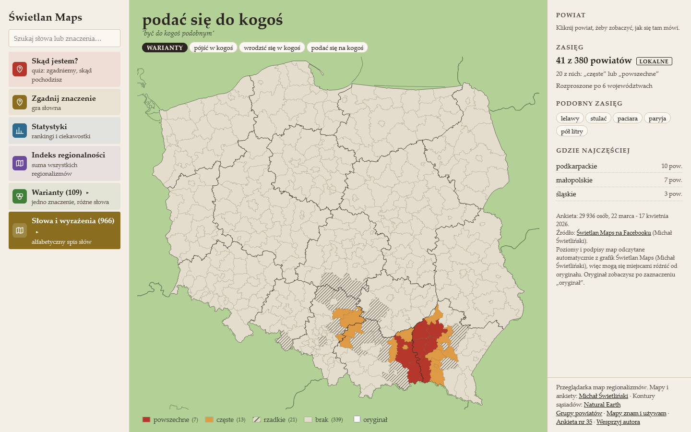
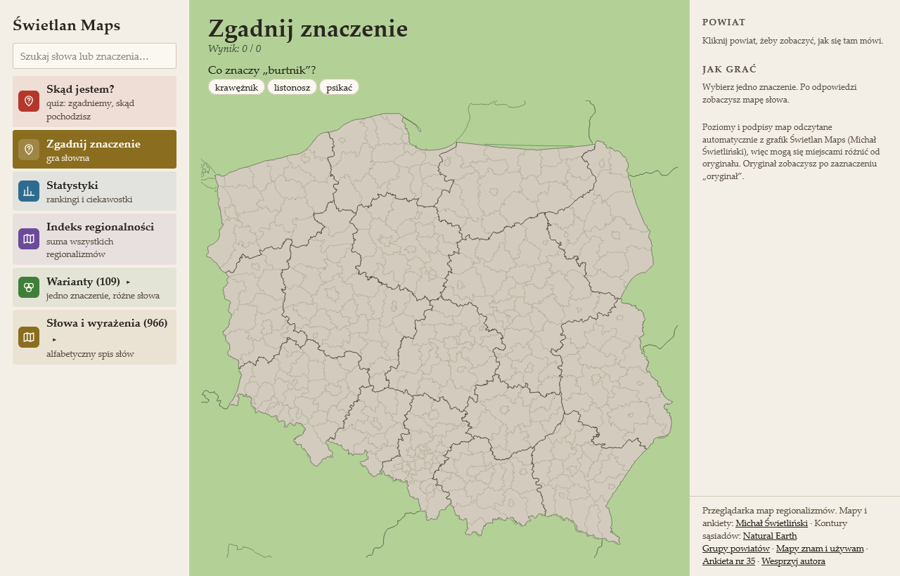
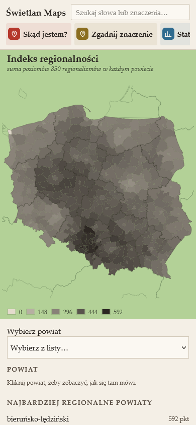

# 🗺️ Świetlan Maps Interactive

**Different places, different words.** Explore Poland's regional vocabulary through the maps and surveys of [Michał Świetliński / Świetlan Maps](https://swietlanmaps.pl/).

**[🧭 Open the interactive map](https://itstomekk.github.io/swietlanmaps/)** · [🎲 Guess a meaning](https://itstomekk.github.io/swietlanmaps/#game) · [📊 Explore county groups](https://itstomekk.github.io/swietlanmaps/kohorty.html) · [☕ Support the author](https://buycoffee.to/swietlanmaps)

## ✨ Start exploring

- **Find a word.** Search for a regional word or its meaning, then open its map.
- **Explore a place.** Click a county, or choose it from the list on a phone, to see the words recorded there.
- **Compare expressions.** Open *Warianty* to see different words for the same idea together or on separate maps.
- **Play.** In *Skąd jestem?*, answer questions about the words you use. In *Zgadnij znaczenie*, try to guess what a regional expression means.
- **Go deeper.** Browse the [regionality index](https://itstomekk.github.io/swietlanmaps/#index), [county groups](https://itstomekk.github.io/swietlanmaps/kohorty.html) and [original “znam / używam” maps](https://itstomekk.github.io/swietlanmaps/procenty.html).

| 🎲 A word game | 📱 On your phone |
| --- | --- |
|  |  |

## 🧭 A note about the maps

County levels are **automatically estimated from published graphics**, not taken from raw survey responses. Some readings and transcribed titles may be inaccurate, especially near borders or in small counties. Use **oryginał** on a word map to compare it with the source.

The surveys are open and self-selected, not representative samples. The quiz is for fun, and county groupings are exploratory rather than official dialect boundaries.

## 🙏 Credits

- **Maps, surveys and results:** Michał Świetliński, [Świetlan Maps](https://swietlanmaps.pl/). The map graphics and survey results belong to their author.
- **County and voivodeship boundaries:** [ppatrzyk/polska-geojson](https://github.com/ppatrzyk/polska-geojson).
- **Surrounding country outlines:** [Natural Earth](https://www.naturalearthdata.com/).
- **Interactive browser:** [Tomek Kołodziejczuk](https://github.com/itstomekk), built to help Świetlan Maps.
- **Social preview image:** the map uses the project's county geometry, with illustrative colours inspired by the “faworki” word group and the original Świetlan Maps palette. It is decorative, not survey data.

## 💬 Help improve it

Found a wrong word, a map reading that needs attention, or a problem on your device? [Open an issue](https://github.com/itstomekk/swietlanmaps/issues) and tell us what you saw. For maps and surveys, visit [Świetlan Maps](https://www.facebook.com/swietlanmaps).

[Development notes](DEVELOPMENT.md) · [Updating the site](UPDATING.md)
