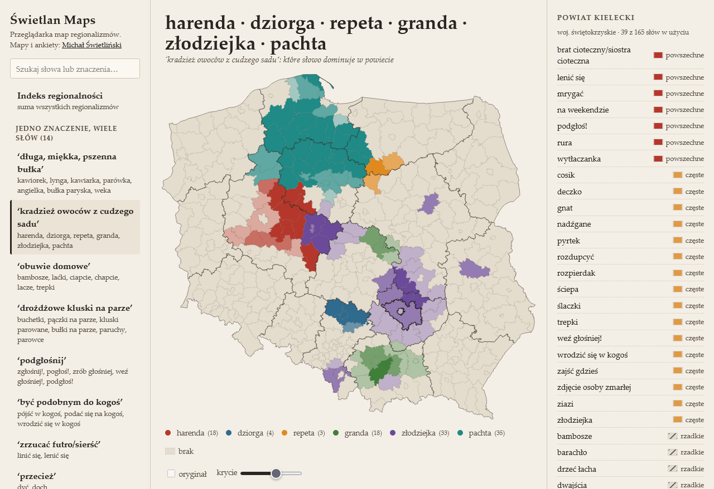
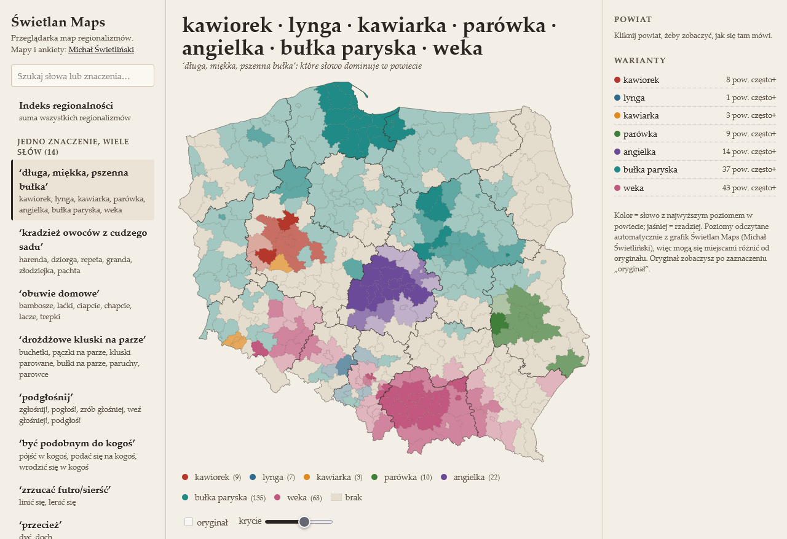
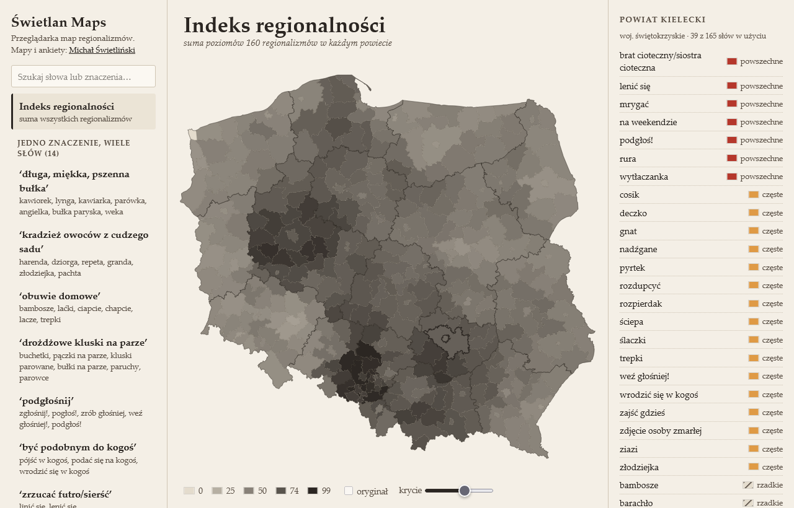
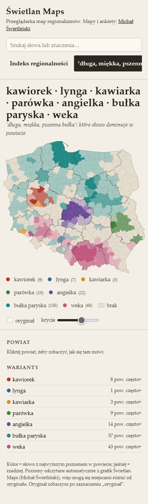

# 🗺️ Świetlan Maps · regionalisms browser

**[Open the browser →](https://itstomekk.github.io/swietlanmaps/)**

> 🇵🇱 Interaktywna przeglądarka map regionalizmów [Świetlan Maps](https://www.facebook.com/swietlanmaps). Wybierz słowo, kliknij powiat i zobacz, jak się tam mówi.

## ✨ What it does

Michał Świetliński runs [Świetlan Maps](https://www.facebook.com/swietlanmaps): large online surveys about regional Polish words, published as maps. This site turns those maps into one searchable, clickable browser.

- 🔎 **Every word in one list.** Search by the word or by its meaning.
- 🧭 **County level.** Each map is read for all 380 powiaty (counties and cities with county rights), on the same scale as the surveys: *powszechne* (common), *częste* (frequent), *rzadkie* (rare).
- 🖱️ **Click a county** to see every regional word used there.
- 🎨 **One meaning, many words.** When several words mean the same thing, one map shows which word wins where.
- 📊 **Regionality index.** All regional words added up per county.
- 🖼️ **Original on top.** Tick *oryginał* to lay the original graphic over the map and compare.
- 🔗 **Shareable links.** Every word has its own address, for example [https://itstomekk.github.io/swietlanmaps/#index](https://itstomekk.github.io/swietlanmaps/#index).

| One word | Regionality index | Phone |
|---|---|---|
|  |  |  |

## ⚠️ Good to know

- The county levels were **read automatically from the published graphics**, not from the raw survey data. They are close to the originals but can differ at the edges of a region, especially for the hatched *rare* areas. The original graphic is always one click away.
- The surveys are open online surveys, so they show where people who answered use a word, not a representative sample.
- More maps are being added. Older map styles (percent maps, multi-panel maps) will come next.

## 🙏 Credits

- **Maps, surveys and results:** Michał Świetliński, [Świetlan Maps](https://www.facebook.com/swietlanmaps). All map graphics and survey results belong to him.
- **County borders:** [ppatrzyk/polska-geojson](https://github.com/ppatrzyk/polska-geojson).
- **Browser:** built by [Tomek Kołodziejczuk](https://github.com/itstomekk) to help Świetlan Maps.

Technical notes: [DEVELOPMENT.md](DEVELOPMENT.md) · How to refresh: [UPDATING.md](UPDATING.md)
